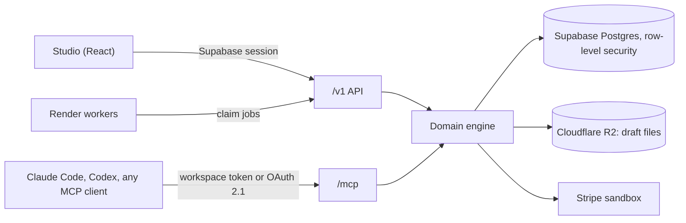

# Faceful

**The video studio you and your AI agent share.**

Describe a short presenter-led video (a Reel, Short or TikTok), shape the drafts with an AI director, and let your own agent (Claude Code, Codex or any MCP client) work in the same projects under the same rules. Nothing is published until a person approves it.

**Live:** [faceful.vercel.app](https://faceful.vercel.app) · **Docs:** [faceful.vercel.app/docs](https://faceful.vercel.app/docs/) · **Status:** [`DEMO_READINESS.md`](DEMO_READINESS.md)

## What it does

- **Drafts, not chat.** A brief becomes editable drafts. Every edit saves a new version, and any earlier version can be restored.
- **An AI director.** Chat beside the canvas. Each change comes back as a proposal with a diff that you apply or discard. It runs on Gemini, Anthropic or the Vercel AI Gateway, whichever key is configured.
- **Your agent in the same studio.** The MCP server at `/mcp` lets an agent create projects, write drafts, edit a reel's timeline and read status. Agents connect with a scoped, expiring workspace token or with OAuth 2.1.
- **People approve.** A schedule is a hashed review of the exact versions, files, accounts and times. Agents can propose one but can never approve it, publish, manage billing or create tokens.
- **Brand kit, presenters and reels.** It covers brand identity and guardrails, products with photos and approved facts, consent-backed presenters from a guided face scan, a Remotion timeline editor that renders MP4s, a template library and publishing to social accounts.
- **A content review before posting.** Each draft's claims are checked against the approved product facts, its spoken words and captions against the script, and its visuals for the named product and readable captions. Health and finance scripts need a named person's approval before they can be scheduled. The review never calls anything "verified".
- **Shared credits.** The studio and agents spend from one balance, billed through Stripe in sandbox mode. Credits are granted only by signed webhooks.

Some features are built but still wait on a service or a migration in production. [`DEMO_READINESS.md`](DEMO_READINESS.md) says exactly what is live.

## How it works

Every surface calls one domain engine (`packages/engine`). The studio, the director, agents over MCP, the scheduler and the webhooks therefore share the same tenancy, scopes, versions, approvals and credits.



| Path | What it is |
| --- | --- |
| `apps/web` | Studio, landing page, public docs (`public/docs`), face scan and the Claude Code page |
| `packages/engine` | Domain engine: tenancy and scopes, projects and versions, files, renders, schedule review, billing, the director and the MCP server |
| `packages/contracts` | Zod schemas shared by the studio, the engine and MCP |
| `packages/public-api` | Public read-only discovery API and its OpenAPI document |
| `packages/cli` | CLI for public reads and local plan validation: `corepack pnpm --silent castroom --help` |
| `api/` | Vercel Function entries for the engine and MCP |
| `supabase/migrations` | Database schema and row-level security |
| `workers/reel-render` | Remotion worker that renders reel timelines to MP4 ([README](workers/reel-render/README.md)) |
| `scripts/render-worker.ts` | Worker client for presenter-video renders through Humanlike |
| `apps/claude-runner`, `apps/machines`, `apps/workspace-store` | Claude Code on one cloud machine per user ([architecture](docs/architecture/claude-machines.md)) |
| `apps/claude-routine` | Starts Claude Code routines with preset commands ([README](apps/claude-routine/README.md)) |
| `tests/` | Unit, contract and Playwright browser tests |

Castroom was the working name. The package, the CLI and some identifiers still use it.

## Run locally

You need Node.js 24 with Corepack; `package.json` pins pnpm 12.

```sh
corepack pnpm install --frozen-lockfile
cp .env.example .env.local     # fill in what you have; anything unset shows as "not connected"
corepack pnpm dev:api          # engine and MCP on http://127.0.0.1:8787
corepack pnpm dev              # studio on http://127.0.0.1:5173, proxying /v1 and /mcp to the engine
```

- **No credentials?** Open `http://127.0.0.1:5173/dev/studio/`. It's a labeled local workspace with sample drafts saved in your browser. It calls no providers and doesn't simulate renders, approvals or posts.
- **The real studio** is `http://127.0.0.1:5173/studio/`, with Supabase sign-in. Your first sign-in creates a personal workspace.
- **Environment variables:** only `VITE_`-prefixed variables reach the browser. Everything else in `.env.example` is server-only, and `.env.local` is gitignored.

## Test

```sh
corepack pnpm quality:lint       # Oxlint; warnings fail
corepack pnpm quality:deadcode   # Fallow: unused files and dependencies, import cycles
corepack pnpm typecheck
corepack pnpm test               # unit and contract tests
corepack pnpm build              # also checks the proxy, the API bundle, the prerendered pages and the CSP
corepack pnpm exec playwright install chromium && corepack pnpm test:ui   # browser tests
node scripts/test-engine-rls.mjs # migrations and RLS in a throwaway database; needs a local psql
corepack pnpm smoke:engine       # live checks against the Supabase project in .env.local
```

CI runs the first five commands on every pull request (`.github/workflows/ci.yml`). `corepack pnpm quality:health` prints an advisory complexity report.

## Deploy

- **Vercel** serves the studio, the docs and the two functions (`api/engine.ts`, `api/mcp.ts`). The functions run in `fra1`, next to the database. Routes and security headers are in `vercel.json`.
- **Configuration:** set the server variables from `.env.example` in the Vercel project. `GET /v1/health` reports which integrations a deployment has configured.
- **Database:** apply `supabase/migrations` to the Supabase project with `supabase db push`.
- **Sample data:** preview builds may set `CASTROOM_ENABLE_FIXTURES=true`. Production builds never include the sample data.
- **Workers:** the render workers and the Cloudflare machines deploy separately; see their READMEs.

## More documentation

- [`SECURITY.md`](SECURITY.md): threat model, controls and how to report a vulnerability (privately, through a GitHub security advisory)
- [`INTEGRATION_CONTRACTS.md`](INTEGRATION_CONTRACTS.md): the API and worker contracts
- [`docs/agents/reel-production.md`](docs/agents/reel-production.md): how an agent builds and renders a reel
- [`STRIPE_SANDBOX_SETUP.md`](STRIPE_SANDBOX_SETUP.md): billing setup
- [`DESIGN.md`](DESIGN.md): the design system
- [`DEMO_RUNBOOK.md`](DEMO_RUNBOOK.md) and [`docs/demo/verification.md`](docs/demo/verification.md): demo script and recorded checks

## Credits

- Humanlike is the presenter-video provider. The recorder that turns its realtime avatar session into a file plugs in through the worker protocol.
- The BeWell sample content comes from Quintessential's published case study. No partnership or media permission is implied.
- Moonjar inspired the spatial composition. None of its assets or code are included.
- Inter Variable is self-hosted under the SIL Open Font License (`apps/web/public/fonts/LICENSE.txt`). Dependencies keep their own licenses.

## License

No license is granted. The code is public to read, but all rights are reserved: copying, modifying or redistributing it requires the authors' permission.
