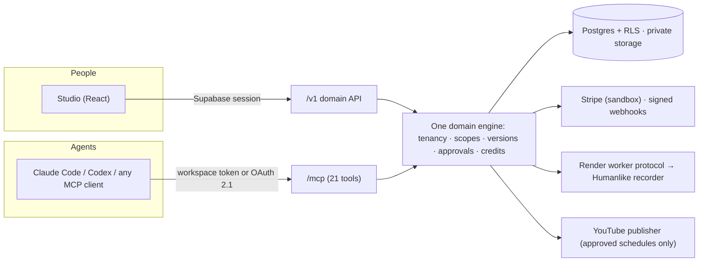

# Faceful — submission

**The video studio you and your AI agent share.**

- Live: <https://faceful.vercel.app> (studio at `/studio/`, agent docs at `/docs/mcp/`)
- Repository: <https://github.com/DimitrisTheo-Dev/Hackathon-gen-ai> (private; access on request)
- Demo video: _link added at submission_ · one-minute pitch surface: <https://faceful.vercel.app/pitch> (press F, then R)
- Status, evidence and limits: [`DEMO_READINESS.md`](../../DEMO_READINESS.md) · how it works: [`INTEGRATION_CONTRACTS.md`](../../INTEGRATION_CONTRACTS.md) · security: [`SECURITY.md`](../../SECURITY.md)

## The problem

Short presenter-led videos (Reels, Shorts, TikToks) are the most effective format for small businesses and agencies, and the slowest to produce: brief, script, presenter, edits, approvals, a posting plan. Meanwhile, people already work with AI agents such as Claude Code and Codex — but an agent alone has nowhere to put the work: no brand memory, no presenter, no versions, no approval step, no billing.

## What Faceful does

1. **Describe a video, get editable drafts.** One composer ("What will we create today?") with format, length and language. Drafts are saved, versioned work — not chat text.
2. **Direct it by chatting.** The AI Director sits beside the canvas. Every change comes back as a proposal with a diff; applying it saves a new version, and every earlier version can be restored.
3. **Your own agent works in the same studio.** A remote MCP server (21 tools) lets Claude Code, Codex or any MCP client create projects, write drafts, edit a reel's timeline and read status in the same workspace, under the same rules. Connect with a scoped, expiring workspace token or OAuth 2.1.
4. **Nothing posts without you.** Scheduling is an exact, hashed review that a person approves; agents can propose but never approve, publish or manage billing.
5. **Brand kit.** Identity, voice, guardrails and sources — every draft, and every agent, starts from it.
6. **Credits shared by the studio and agents,** billed through Stripe (sandbox), granted only by signed webhooks.

## What is real today (verified on production)

| Capability | Evidence |
| --- | --- |
| Sign-in (email code, Google) and first-run workspace provisioning | 32 live checks against the hosted database (`docs/demo/evidence/engine/smoke-live-supabase.txt`) |
| Drafting, versions, restore, tenant isolation, row-level security | Unit tests, local Postgres RLS checks, live checks |
| MCP: Claude Code against the production endpoint created and revised drafts; Codex against the same engine | `docs/demo/evidence/production/mcp-and-oauth.md` |
| OAuth 2.1 for agents: discovery, dynamic registration, consent page, PKCE token, refresh | same file |
| "Use your own Claude subscription": the studio hands a request to the person's Claude Code, which writes Greek drafts through Faceful's tools | same file |
| Stripe sandbox: hosted Checkout (test card), plan and credits granted only by signed webhooks, Customer Portal cancellation reflected, double-subscription guard, declined cards grant nothing | `docs/demo/evidence/production/stripe-sandbox.md` |
| Rate limits (Postgres-backed, IETF `RateLimit` headers), 256 KB body cap, HSTS/COOP/CSP, MCP batch cap | production checks of 15 Nov; `SECURITY.md` |
| Studio refresh: one continuous loading state, zero layout shift | measured on production with a signed-in session |
| Works in Chromium, Safari (WebKit) and Firefox; no serious or critical axe findings (WCAG 2.2 AA) on 12 surfaces at desktop and phone widths; landing Lighthouse 100 mobile and desktop on a compressed server | 342 browser tests across three engines; `docs/demo/evidence/quality/` |

**What is live and what still waits (stated plainly in the product too):**
- **Presenter-video rendering** waits for the Humanlike recorder.
- **The reel editor** (Remotion timeline, draft files, MP4 renders), **Personas**, **Clone a video** and **social accounts** (Buffer, or Instagram directly) are built. They are reachable on production and wait on their services: a files store, a render worker, and Buffer or Instagram credentials.
- **YouTube publishing** is built but not yet verified with a real channel. TikTok needs the platform's app review or Buffer.
- **Live today:** AI drafting and edits through the Director (Gemini on production), and the template library: 11 formats with rendered Greek samples.

## How it works

The studio, the AI Director and every MCP tool call the same engine functions. There is no second code path for agents.

## Agentic and security practices

- **One engine, one rulebook:** agents and people share functions, scopes and audit; agents are capped below human authority (no approval, publishing, billing management or token administration).
- **Tenancy from credentials, never from requests;** wrong-workspace IDs read as "not found".
- **Scoped, expiring, hashed tokens;** OAuth 2.1 with PKCE via Supabase Auth; protected-resource metadata for discovery.
- **Idempotent side effects** (operation keys), compare-and-swap revisions, exactly-once credit holds and refunds.
- **Signed Stripe webhooks,** sandbox-only keys enforced at boot, entitlements only from verified events.
- **Prompt-injection hygiene:** sources, brand text and history are passed to the model as data; the model has no tools and can only propose typed actions a person applies.
- **Rate limits, security headers, no secrets in the browser** — see `SECURITY.md`.
- **Verified, not assumed:** a pre-submission review found an operation-dispatch bug and a missed Stripe cancellation shape; both were fixed, covered by tests and re-checked on production. `DEMO_READINESS.md` labels every capability as verified live, implemented-not-verified, blocked or deferred.

## Built with

React 19, Vite, TypeScript, Supabase (Auth, Postgres, Storage), Vercel Functions, the Model Context Protocol TypeScript SDK, Stripe, Resend, Gemini for the Director (Claude through the Anthropic SDK is also supported), Humanlike for presenters.

## Team

Dimitris Theodoropoulos — product, studio and engine. Minas Kontis — Humanlike avatars and the Claude Code runner.

## What's next

Connect the Humanlike recorder so every draft renders into a presenter video; verify YouTube end to end; apply for Instagram and TikTok publishing; usage-based plans for agencies managing many brands.
